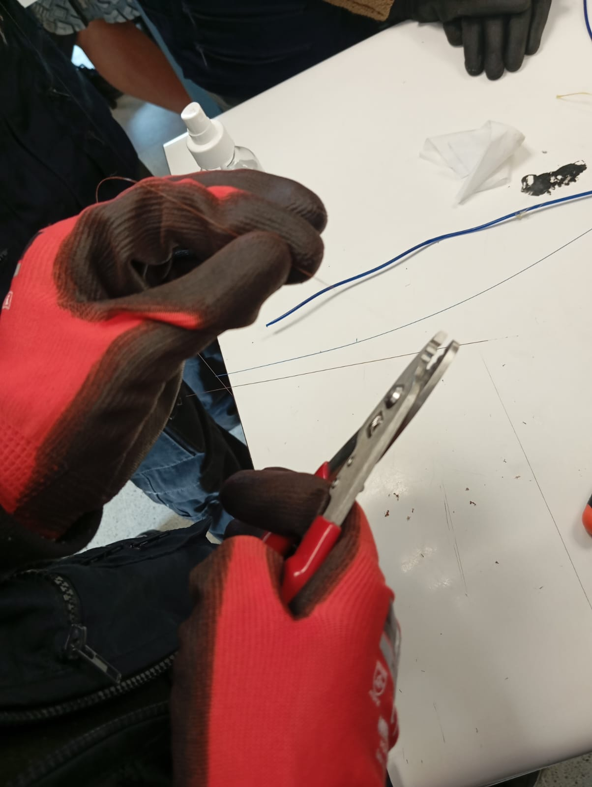
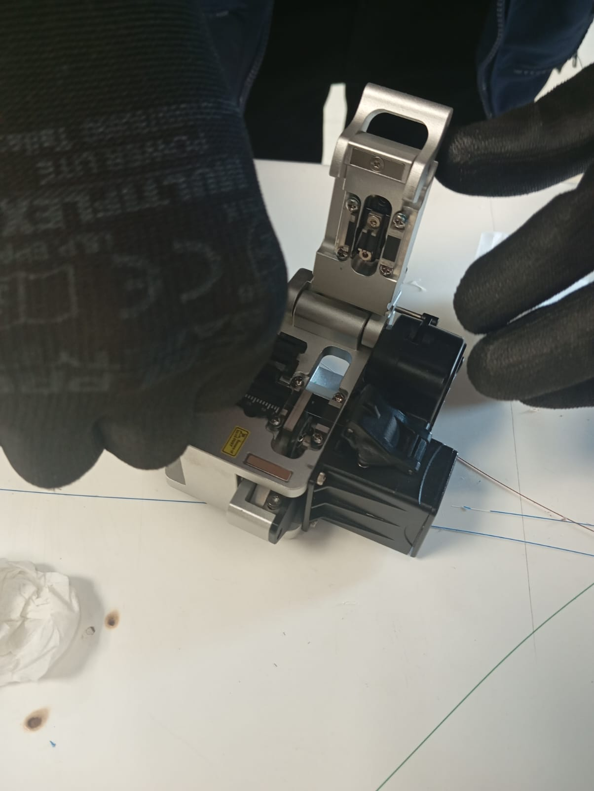
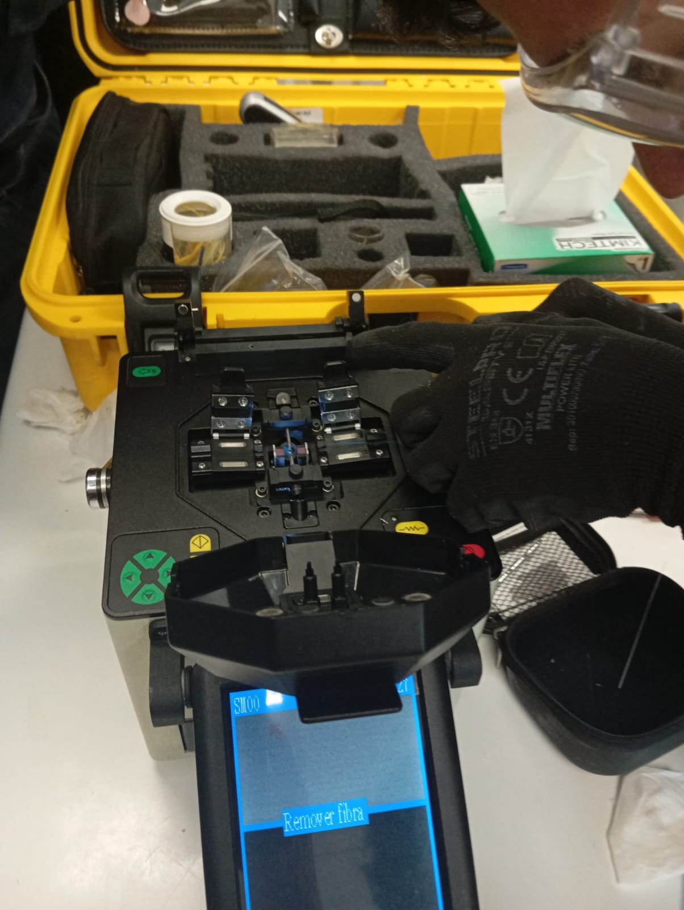
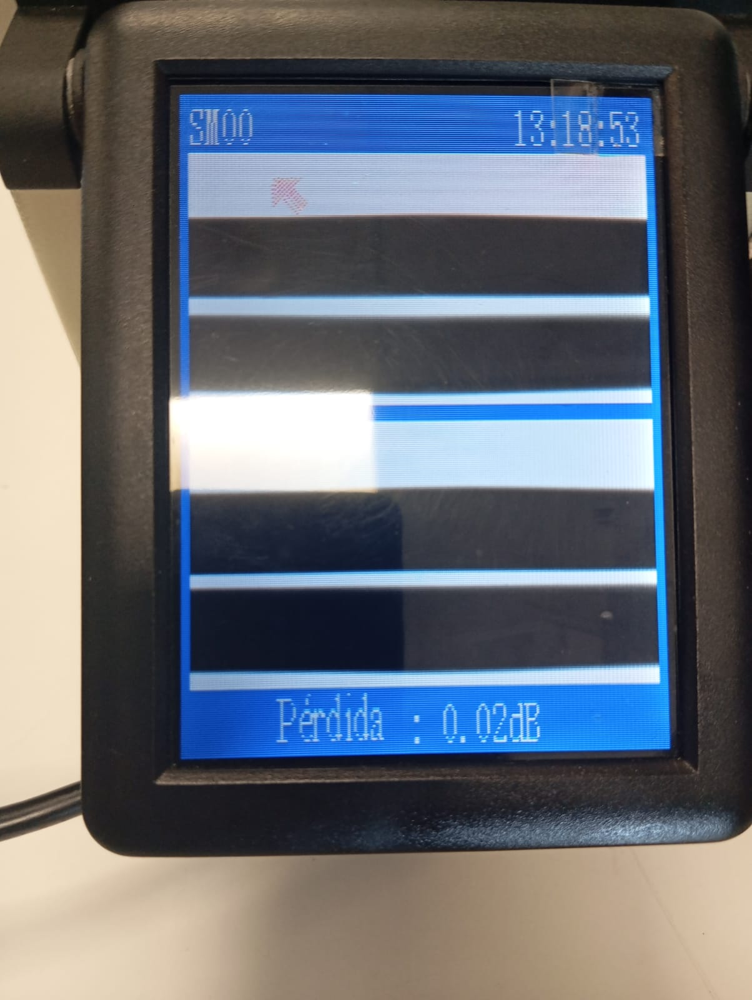

Manual Técnico: Fusión de Fibra Óptica
Estudiante: Benjamin Nicolas Alvarez Aguilera  
Carrera:Ingeniería en Telecomunicaciones  
Asignatura:Infraestructura de Redes (TCB304)  
Institución:INACAP  
Sede: La Serena  

---

1. Introducción

La fibra óptica es un medio de transmisión que permite transportar información mediante pulsos de luz a través de filamentos de vidrio. Es utilizada en las redes de telecomunicaciones debido a su gran capacidad de transmisión, velocidad y bajas pérdidas de señal.

La termofusión es un procedimiento utilizado para unir dos fibras ópticas mediante una fusionadora que emplea un arco eléctrico. Este proceso permite obtener una unión permanente, procurando mantener una baja atenuación y una buena continuidad de la señal.

El presente manual describe los principales procedimientos necesarios para realizar una fusión de fibra óptica, considerando la seguridad, preparación del material, limpieza, corte de precisión, termofusión y verificación de resultados.

2. Objetivos

Objetivo general

Documentar el procedimiento técnico de preparación y fusión de fibra óptica, considerando las medidas de seguridad y los parámetros necesarios para obtener un empalme de calidad.

Objetivos específicos

- Identificar los materiales y herramientas utilizados en la práctica.
- Aplicar medidas de seguridad durante la manipulación de fibra óptica.
- Describir los procesos de stripping, limpieza y cleaving.
- Explicar el funcionamiento de la fusionadora.
- Calcular el presupuesto óptico de un enlace.
- Registrar los resultados de las mediciones realizadas.

3. Glosario técnico

Núcleo (Core):Parte central de la fibra óptica por donde se transmite la luz. Posee un índice de refracción mayor que el revestimiento.

Cladding:Revestimiento de vidrio que rodea al núcleo y permite mantener la luz confinada mediante el fenómeno de reflexión interna total.

Cleaving:Procedimiento de corte de precisión de la fibra óptica que busca obtener una superficie perpendicular para facilitar la fusión.

Atenuación: Pérdida de potencia de la señal óptica durante su transmisión. Se expresa generalmente en decibelios (dB) o decibelios por kilómetro (dB/km).

4. Materiales y herramientas

Para realizar el procedimiento de fusión de fibra óptica se utilizan los siguientes elementos:

- Fusionadora de fibra óptica.
- Cortadora de precisión (Cleaver).
- Pinza peladora de fibra óptica.
- Alcohol isopropílico.
- Paños libres de pelusa.
- Manguitos termocontraíbles.
- Cable de fibra óptica.
- Recipiente adecuado para residuos de fibra.
- Lentes de seguridad.

5. Seguridad y preparación

Antes de comenzar la práctica se deben considerar las medidas de seguridad correspondientes.

- Utilizar lentes de seguridad durante toda la manipulación.
- Evitar el contacto directo con los fragmentos de fibra.
- Mantener limpia y ordenada el área de trabajo.
- Depositar los restos de fibra en un contenedor adecuado.
- Utilizar los productos de limpieza según las indicaciones del laboratorio.

Advertencia:Los fragmentos de fibra óptica pueden ser difíciles de visualizar y deben manipularse con precaución. Nunca deben dejarse sobre la mesa de trabajo.

6. Procedimiento técnico

6.1 Stripping (Pelado de fibra)

El stripping consiste en retirar las capas protectoras del cable de fibra óptica mediante una pinza peladora adecuada, dejando expuesto el vidrio de la fibra de 125 micras.

Este procedimiento requiere precisión para evitar daños o rayaduras en el vidrio.

Imagen de la práctica:

6.2 Limpieza de precisión

Una vez retirada la protección, se realiza la limpieza de la fibra utilizando alcohol isopropílico de alta pureza y paños libres de pelusa.

El objetivo es eliminar partículas de suciedad y residuos que puedan afectar la calidad del empalme.

6.3 Cleaving (Corte de precisión)

El cleaving consiste en realizar un corte preciso en el extremo de la fibra utilizando una cortadora especializada.

El objetivo es obtener una superficie de corte perpendicular, cercana a los 90 grados, para facilitar la alineación y unión de ambas fibras.

Imagen de la práctica:

6.4 Proceso de termofusión

La termofusión permite unir dos extremos de fibra óptica mediante una fusionadora.

El equipo realiza la alineación de las fibras y utiliza un arco eléctrico para generar la unión entre ambos extremos.

La calidad del empalme depende de la preparación, limpieza, corte y alineación de las fibras.

Imagen de la práctica:

6.5 Protección del empalme

Después de realizar la fusión, se instala un manguito termocontraíble sobre la unión.

Este elemento proporciona protección mecánica al empalme y ayuda a mantener su integridad.

7. Presupuesto óptico

El presupuesto óptico permite estimar las pérdidas de potencia que experimenta una señal durante su recorrido por un enlace de fibra óptica.

Se deben considerar:

- Atenuación de la fibra por kilómetro.
- Pérdidas producidas por los conectores.
- Pérdidas producidas por los empalmes.
- Margen de ingeniería correspondiente.

7.1 Fórmula de cálculo

Pérdida total:

PT = (L × α) + (Nc × Pc) + (Ne × Pe)

Donde:

- L: longitud del enlace en kilómetros.
- α: atenuación de la fibra en dB/km.
- Nc: cantidad de conectores.
- Pc: pérdida por conector en dB.
- Ne: cantidad de empalmes.
- Pe: pérdida por empalme en dB.

7.2 Tabla de presupuesto óptico

| Elemento  | Cantidad | Pérdida unitaria | Pérdida total |
| Fibra O.  |   km     |  dB/km           |       dB      |
| Conectores|          |  dB              |       dB      | 
| Empalmes  |          |  dB              |       dB      |
| Total     |          |                  |       dB      |

Los valores deben completarse utilizando los datos reales de la práctica o los entregados por el docente.

7.3 Margen GPON

El presupuesto óptico debe compararse con la pérdida máxima permitida para la clase GPON utilizada en el enlace.

Presupuesto disponible = Potencia óptica de transmisión - Sensibilidad del receptor.

Margen restante = Presupuesto disponible - Pérdida total del enlace.

8. Medición y verificación

Una vez finalizado el empalme, se deben registrar los resultados obtenidos mediante los instrumentos disponibles en el laboratorio.

| Parámetro                        | Resultado                  |
| Continuidad de fibra             | [Completar]                |
| Pérdida estimada por fusionadora | [Completar] dB             |
| Pérdida medida | [Completar] dB  |                            |   
| Estado del empalme               | [Completar]                |   

La verificación permite comprobar que la unión se realizó correctamente y que las pérdidas se encuentran dentro de los valores aceptables para el enlace.

9. Conclusión

La fusión de fibra óptica es un procedimiento fundamental en la implementación de redes de telecomunicaciones, ya que permite unir fibras manteniendo una baja pérdida de señal.

Durante este procedimiento, la preparación, limpieza y precisión del corte son factores importantes para conseguir un empalme de calidad.

Además, el cálculo del presupuesto óptico y la verificación mediante instrumentos permiten evaluar el comportamiento del enlace y comprobar que cumple con los requisitos técnicos establecidos.
